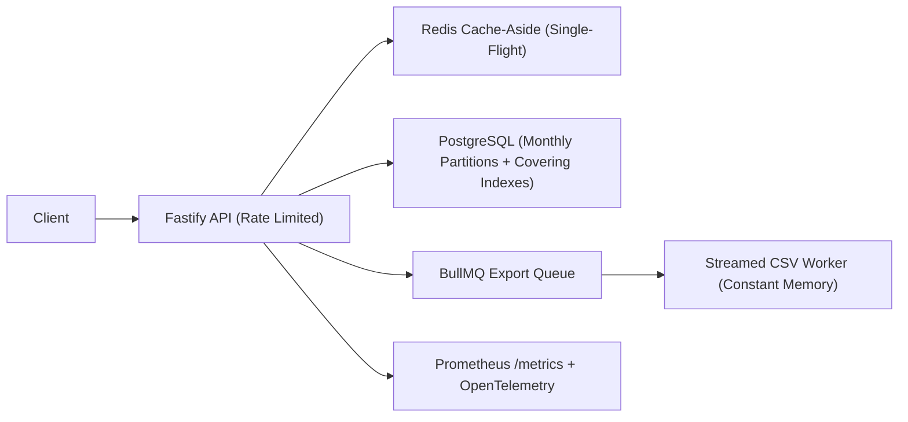

# High-Throughput Transaction Query & Async Reporting Engine

A Fastify + Partitioned PostgreSQL + Redis + BullMQ + OpenTelemetry/Prometheus service built to demonstrate **sub-200ms p95 queries over millions of rows**, **cache stampede protection**, **streamed async CSV exports**, and **PII-safe observability**.

## Architecture



## Key Engineering Highlights
1. **Partitioned Storage & Covering Indexes:** Monthly `RANGE (created_at)` partitions with `idx_tx_tenant_created_id_cover` (`INCLUDE` columns for index-only scans) and a partial index for `PENDING` transactions.
2. **Keyset/Cursor Pagination:** Replaces `OFFSET` scans with `(created_at, id) < ($cursorCreatedAt, $cursorId)` for constant-time pagination at any depth.
3. **Stampede-Safe Caching:** `StampedeSafeCache` coalesces concurrent in-flight cache misses so a hot key expiry triggers only one DB query.
4. **Streamed Async Exports:** `POST /v1/exports` returns `202 Accepted` and streams batches directly to disk with backpressure handling (`stream.write` / `drain`).
5. **PII-Redacted Logging & Metrics:** Pino redacts sensitive fields (`authorization`, `cardNumber`, `bvn`, `pin`, `customer_email`) while Prometheus + OpenTelemetry track p95/p99 latency and cache hit ratios.

## Quick Start

```bash
make up
make seed   # Seeds 1,000,000 synthetic rows (set ROW_COUNT=5000000 for 5M)
make bench  # Runs k6 load test with p(95)<200ms threshold
```
